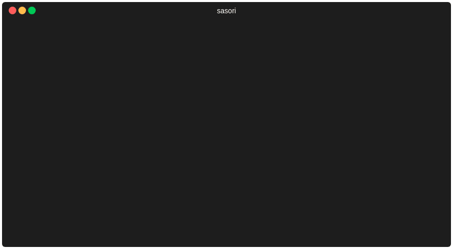
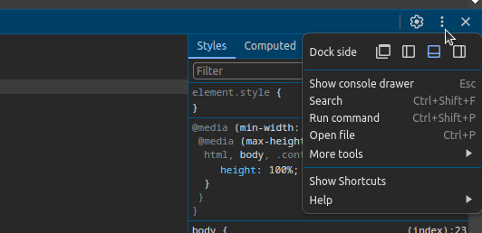
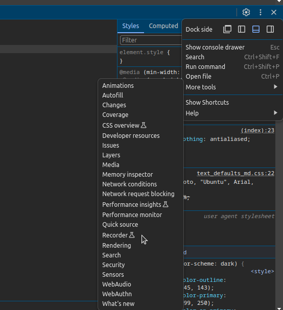
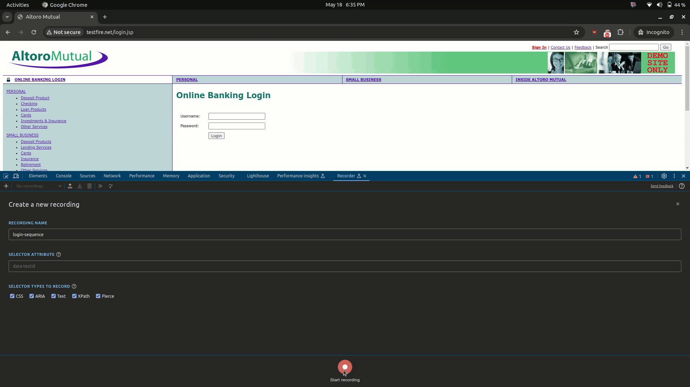
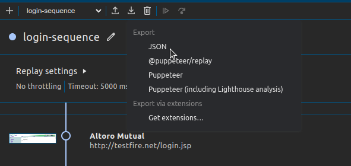

<p align="center">
  
</p>

<p align="center">
  <a href="https://www.npmjs.com/package/sasori-crawl"></a>
  <a href="https://www.npmjs.com/package/sasori-crawl"></a>
  
  <a href="LICENSE"></a>
  
</p>

<p align="center"></p>

## Contents

- [What is Sasori](#what-is-sasori)
- [Why use it](#why-use-it)
- [Features](#features)
- [How it works](#how-it-works)
- [Requirements](#requirements)
- [Quick start](#quick-start)
- [Ways to run Sasori](#ways-to-run-sasori)
- [Output files](#output-files)
- [Configuration](#configuration)
- [Proxy and TLS](#proxy-and-tls)
- [Creating a Puppeteer recording](#creating-a-puppeteer-recording)
- [Contributing](#contributing)
- [License](#license)

## What is Sasori

Sasori drives a real Chromium browser through a web application and reports every
URL it reaches. It clicks links and buttons, fills inputs, follows pages that
load content with JavaScript, and can log in first so it can reach pages that
sit behind authentication. You can point it at a proxy such as ZAP or Burp so a
scanner sees everything the crawl touches.

The name means scorpion. The crawler walks an app the way a scorpion walks the
ground, one careful step at a time, and keeps track of where it has already
been.

## Why use it

A plain crawler that only reads HTML misses most of a modern web app. Menus open
with JavaScript, forms submit over AJAX, and whole screens never change the URL.
Sasori uses a real browser, so it sees those screens and the requests they make.
It also understands login, scope, and proxies, which are the three things you
need for crawling a target during a security test.

## Features

| Feature | What it does |
| --- | --- |
| Dynamic crawling | Uses a real browser, so it handles AJAX content and screens that never change the URL. |
| Authentication | Logs in before the crawl using a Chrome DevTools recording, or HTTP Basic auth. |
| Proxy support | Routes all traffic through a proxy such as ZAP or Burp for security testing. |
| Scope control | Include and exclude rules decide which URLs count as in scope. |
| State model | Tracks URLs, page states, and clickable elements so it does not crawl the same thing twice. |
| Concurrency | Runs several browsers at once against one shared crawl graph. |
| Custom targets | You choose which elements Sasori clicks, so you can aim it at specific flows. |
| Coverage reports | Writes a list of URLs, an endpoint inventory, and a crawl graph you can diff and render. |
| API mode | A REST server runs many scans at once, one config per scan. |

## How it works

Sasori builds a map of the app while it crawls. Each page state is a node. Each
click is an edge that leads to another state. When a click produces a page it has
seen before, Sasori joins the branches instead of crawling the page again, which
keeps the crawl from going in circles.

Because several browsers share one map, the page in front of a browser is not
always the one it needs next. When that happens, Sasori loads a known URL and
replays only the clicks needed to get back to the right place, rather than
starting over from the home page every time.

Scope is enforced on every request. Requests that are in scope are recorded and
allowed through. Requests that are out of scope get a synthetic response and go
no further, so the crawl stays on the target you asked for.

## Requirements

- Node.js 22.12 or newer (Puppeteer 25's minimum)
- A Chromium browser, which Puppeteer installs for you
- `libnss3-tools` only if you use a proxy CA, see [Proxy and TLS](#proxy-and-tls)

## Quick start

Install Sasori, create a config, edit it, and run.

```bash
npm install -g sasori-crawl
sasori init
# edit config.json, see the Configuration section
sasori start --config ./config.json --output urls.txt
```

When the crawl finishes, `urls.txt` holds every in scope URL it reached.

## Ways to run Sasori

### Install from npm

```bash
npm install -g sasori-crawl
sasori init
sasori start --config /path/to/config.json
```

### Install from source as the `sasori` command

Builds this checkout and installs it globally, the same way the npm package
would be installed:

make install        # install dependencies
make install-app    # build, pack, and npm install -g the result
sasori --help
```

`make install-app` installs a packed copy, not a link to the checkout, so
rebuilding or switching branches does not change the installed `sasori` until
you run it again. `make uninstall-app` removes it. If your global npm prefix
needs root, use a Node version manager, or set a user prefix with
`npm config set prefix ~/.local` and put `~/.local/bin` on your `PATH`.

### Run from source without installing

Sasori runs from the built output in `dist/`. Every `run-*` target builds first,
so a change is always picked up:

```bash
make install                                   # once: install dependencies
make run-cli CONFIG=path/to/config.json        # one crawl
make run-crawl CONFIG=path/to/config.json \
    INVENTORY=inv.json CRAWL_GRAPH=graph.json  # one crawl, plus inventory and crawl graph
make run                                       # API server on port 3100 (what nara-backend calls)
make run-api HOST=127.0.0.1 PORT=8080          # API server on another host or port
```

| Command | What it does |
| --- | --- |
| `make install` | Install dependencies (`npm install`). |
| `make build` | Compile TypeScript into `dist/` and copy `config/` there. |
| `make run-cli` | Build, then run one crawl with `CONFIG` (default `config/config.json`). |
| `make run-crawl` | Build, then run one crawl and write `INVENTORY` and `CRAWL_GRAPH`. |
| `make run` | Build, then start the API server on `PORT` (default `3100`). |
| `make run-api` | Build, then start the API server on `HOST` and `PORT`. |
| `make install-app` | Build, then install the `sasori` command globally. |
| `make uninstall-app` | Remove the global `sasori` command. |
| `make package-zip` | Zip `dist/` and the manifests for a server that runs `npm ci`. |
| `make help` | List every target, including tests, lint and benchmarks. |

Without make, the same steps are:

```bash
```bash
git clone https://github.com/karthikuj/sasori.git
cd sasori
npm install
npm run build
node dist/bin/index.js start --config ./config/config.json
```

### Start a single crawl

```bash
sasori start --config ./config.json [--output urls.txt] [--inventory inv.json] [--crawl-graph graph.json]
```

| Flag | Alias | What it does |
| --- | --- | --- |
| `--config` | `-c` | Path to the config file. Required. |
| `--output` | `-o` | Write every in scope URL to this file. |
| `--inventory` | `-i` | Write the endpoint and state inventory as JSON. |
| `--crawl-graph` | `-g` | Write the crawl graph as JSON, plus `.mmd` and `.dot` versions next to it. |

Press Ctrl+C to stop early. Sasori unwinds cleanly and still writes the output,
inventory, and crawl graph for what it covered so far.

### Run the API server

Start a server that runs many scans at once. Each scan is a POST whose JSON body
is a full crawler config.

```bash
sasori api --host 0.0.0.0 --port 8080
```

| Method and path | What it does |
| --- | --- |
| `POST /api/v1/scans` | Start a scan. The body is a crawler config. |
| `GET /api/v1/scans` | List scans. |
| `GET /api/v1/scans/:id` | Get the status of one scan. |
| `GET /api/v1/scans/:id/inventory` | Get the inventory for one scan. |
| `GET /api/v1/scans/:id/crawl-graph` | Get the crawl graph for one scan. |
| `DELETE /api/v1/scans/:id` | Stop a scan. |
| `GET /health` | Health check. |

## Output files

Sasori can write three kinds of output, and you can ask for any mix of them.

- **URL list** (`--output`): a plain list of every in scope URL the crawl
  reached. This is the simplest way to feed results into another tool.
- **Inventory** (`--inventory`): a JSON report of what the crawl reached,
  grouped by endpoint and by page state. Endpoints keep their parameter names,
  since those names are the attack surface. The file is sorted and carries no
  timestamps, so two crawls that reach the same surface produce the same file
  and a diff shows a real change in coverage.
- **Crawl graph** (`--crawl-graph`): a JSON graph of states and the clicks
  between them, with the status of each click. It is also written as a Mermaid
  file you can render on GitHub and a DOT file for large graphs. This is the
  file to read when you want to know why something was or was not crawled.

## Configuration

A config file has three sections. `browser` and `crawler` are required, and
`logging` is optional. The types live in `src/types/`, and a working example
ships in `config/config.json`.

### Browser

Settings for the browser that does the crawling.

- **headless**: run the browser with no window. Default `false`.
- **maximize**: maximize the browser window. Default `false`.
- **instances**: how many crawl workers run at the same time.
- **sessionMode**: how the workers share a login. Default `"shared"`.
  - `"shared"`: one browser, logged in once, with one window per worker. Every
    window shares the browser's cookies and storage, so every worker is logged
    in, the way your own Chrome is logged in to a site in every window. It also
    works on apps that allow only one session per user.
  - `"perBrowser"`: one browser per worker, each logging in on its own. Use it
    for an app that keeps its login only in `sessionStorage`, which a browser
    does not share between windows. Sasori warns when it sees a login there.
- **proxy**: proxy settings.
  - **enabled**: turn the proxy on.
  - **host**: proxy host. Required when the proxy is on.
  - **port**: proxy port. Required when the proxy is on.
- **tls**: optional TLS settings for proxied HTTPS.
  - **extraCaCerts**: paths to PEM CA files the crawler should trust, used for a
    proxy that intercepts HTTPS.
  - **allowInsecureFallback**: allow Sasori to skip certificate checks when it
    cannot import your CA. Off by default on purpose.

### Crawler

Settings for how the crawl behaves.

- **entryPoint**: the URL the crawl starts from. Required.
- **eventTimeout**: how long to wait for an event, in milliseconds. Required.
- **navigationTimeout**: how long to wait for a page to load, in milliseconds. Required.
- **eventWait**: how long to wait between events, in milliseconds. Required.
- **maxDuration**: how long the crawl may run, in milliseconds. `0` means run until done. Required.
- **maxActionRetries**: how many times to retry a failed click before dropping it.
- **elements**: the elements Sasori clicks, as CSS selectors. Use `[click]` to
  find elements that have a click handler. Required.
- **maxChildren**: how many children to crawl from each state. `0` means no limit. Required.
- **maxDepth**: how deep the crawl may go. `0` means no limit. Required.
- **includeRegexes**: a URL counts as in scope when it matches one of these.
- **excludeRegexes**: a URL is dropped when it matches one of these, even if it was included.
- **debugNetwork**: log extra network detail while crawling.
- **extraSeeds**: more URLs to start crawling from, as well as `entryPoint`.
  Each one starts its own crawl tree. Trees that reach the same page merge.
  Sasori skips seeds that are out of scope.
- **sitemap**: find more starting URLs in the site's `robots.txt` and sitemaps.
  Sasori reads them from the entry point's origin before the crawl starts.
  Seeds load one at a time, and that time counts toward `maxDuration`. When
  time runs out, Sasori stops loading seeds and crawls from the ones it has.
  - **enabled**: turn sitemap discovery on.
  - **maxSeedUrls**: the most starting URLs to take from sitemaps. Default `100`.
  - **maxSitemapDepth**: how many levels of sitemap index to follow. Default `3`.
  - **maxSitemapUrls**: the most URLs to read across all sitemaps. Default `5000`.
  - **respectRobots**: obey `robots.txt` `Allow` and `Disallow` rules for the
    whole crawl, not only for the starting URLs. A disallowed URL is treated
    as out of scope. Default `true`.
- **authentication**: login settings.
  - **basicAuth**: HTTP Basic auth.
    - **enabled**: turn Basic auth on.
    - **username**: required when enabled.
    - **password**: required when enabled.
  - **recorderAuth**: login with a recorded flow.
    - **enabled**: turn recorder auth on.
    - **pptrRecording**: path to a [Puppeteer recording](#creating-a-puppeteer-recording). Use an absolute path. Required when enabled.
  - **sessionCheck**: check that the crawl is still logged in, and log in again
    if it is not. Used with recorder auth. After logging in, Sasori picks one
    of the app's own API calls (fetch/XHR `GET`s only, never page loads) whose
    answer changes without the login, and repeats it on a timer. It prefers a
    call whose **status** changes (401/403, a redirect to the login page); if
    only the **body** changes, it keeps a few markers only the logged-in
    answer has, such as your email, and a check without them is a logout. If
    no API call qualifies, Sasori says so and asks you to set `url` and
    `loggedInRegex`. Each time, every worker first finishes the action it is
    on and pauses, and the check is sent from one of their windows. When it
    answers like a logged-out request, Sasori clears the dead session and
    logs in again in that one window. The other windows share its cookies, so
    they are logged in too and nothing is restarted; then every worker
    carries on. If logging in again that way fails, the browser restarts on a
    fresh profile. After three failed restarts in a row, the crawl stops with
    an error.
    - **enabled**: default `true` when recorder auth is on.
    - **intervalMs**: time between checks, in milliseconds. Default `120000`.
      At least `10000`.
    - **url**: a `GET` URL that only works while logged in. Set it for an app
      that makes no API calls after login, where Sasori cannot find one itself.
      Without `loggedInRegex`, Sasori judges it by status or markers as above.
    - **loggedInRegex**: a regular expression (JavaScript, case-sensitive) that
      `url`'s response matches only while logged in, for example
      `Welcome! \w+`. When it stops matching, the crawl is logged out. Use it
      for pages that answer 200 either way and differ only in their text. It
      must match right after login, or the check is refused. Needs `url`.
  - **reloginIntervalMs**: log in again on this schedule, in milliseconds,
    whether or not the session looks expired. The browser restarts on a fresh
    profile each time. `0`, the default, turns it off; otherwise at least
    `60000`.

### Logging

Optional. When set, Sasori tees its console output to a log file that rotates by
size. Leave this section out to log to the screen only.

- **file**: path to the log file.
- **console**: also keep printing to the screen.
- **maxSizeMB**: rotate the file once it passes this size.
- **maxBackups**: how many old files to keep.
- **maxAgeDays**: how long to keep old files.
- **compress**: compress rotated files.

### Example

```json
{
  "browser": {
    "headless": true,
    "maximize": true,
    "proxy": {
      "enabled": true,
      "host": "127.0.0.1",
      "port": 3200
    },
    "instances": 1
  },
  "crawler": {
    "entryPoint": "https://demo.testfire.net/bank/main.jsp",
    "eventTimeout": 10000,
    "navigationTimeout": 30000,
    "eventWait": 0,
    "maxActionRetries": 3,
    "maxDuration": 0,
    "elements": ["a", "button", "input[type=\"submit\"]", "[click]"],
    "maxChildren": 0,
    "maxDepth": 10,
    "authentication": {
      "basicAuth": {
        "enabled": false,
        "username": "username",
        "password": "password"
      },
      "recorderAuth": {
        "enabled": true,
        "pptrRecording": "/path/to/recording.json"
      }
    },
    "includeRegexes": ["https?://demo.testfire.net(?:/.*|)"],
    "excludeRegexes": [".*logout.*"],
    "extraSeeds": [],
    "sitemap": {
      "enabled": false,
      "maxSeedUrls": 100,
      "maxSitemapDepth": 3,
      "maxSitemapUrls": 5000,
      "respectRobots": true
    }
  },
  "logging": {
    "file": "logs/sasori.log",
    "console": true,
    "maxSizeMB": 100,
    "maxBackups": 20,
    "maxAgeDays": 30,
    "compress": true
  }
}
```

## Proxy and TLS

When you crawl through a proxy that intercepts HTTPS, the browser has to trust
the proxy CA or every HTTPS page fails. Set `browser.tls.extraCaCerts` to your
CA file and Sasori imports it into a fresh browser profile so HTTPS validates
the right way.

This needs the `certutil` tool. If you see this warning:

```text
[sasori] browser.tls.extraCaCerts: certutil not found (install nss-tools / libnss3-tools) to use browser.tls.extraCaCerts — falling back to --ignore-certificate-errors when a proxy is used
```

install the NSS tools:

```bash
# Debian, Ubuntu, Kali
sudo apt update && sudo apt install -y libnss3-tools
```

Then run Sasori again. Without `certutil`, Sasori falls back to ignoring
certificate errors while proxying HTTPS, which is less safe, so install the tool
when you can.

## Creating a Puppeteer recording

Use Chrome to record your login steps, then point `recorderAuth.pptrRecording`
at the exported file.

1. Open DevTools in Google Chrome and click the three dots in the top right corner.

<p align="center">
  
</p>

2. Go to `More tools` then `Recorder`.

<p align="center">
  
</p>

3. Click `Create a new recording`.

4. Give it a name and click `Start recording`.

5. Do the login steps, then click `End recording`.

<p align="center">
  
</p>

6. Export the recording by clicking the download arrow and choosing `JSON`.

<p align="center">
  
</p>

To run a custom script during login, add a step to the flow, set its type to
`customStep`, set its name to `executeScript`, and in the `parameters` field add
a JSON object with a `target` key whose value is the script you want to run.

## Contributing

Contributions are welcome. If you find a bug, have an idea, or want to improve
the code, please read [CONTRIBUTING.md](CONTRIBUTING.md) first.

## License

Sasori is released under the [MIT License](LICENSE).
</content>
</invoke>
